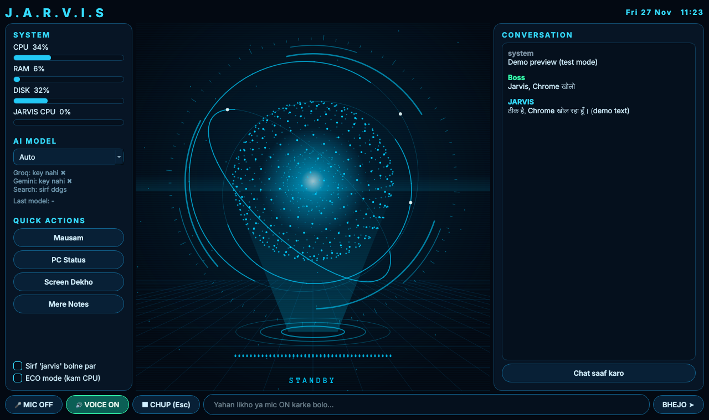

# 🤖 J.A.R.V.I.S Desktop Agent

Hinglish/Hindi mein baat karne wala desktop assistant: 3D hologram GUI, Groq + Gemini AI, voice input aur voice reply.

*Preview test mode ka screenshot hai; chat mein demo text hai.*

## Features
- 3D hologram animation (QPainter + numpy, OpenGL ki zarurat nahi), ECO mode
- Hamesha sunne wala mic aur voice reply, dono ON/OFF
- Groq aur Gemini, fail hone par automatic fallback
- Web search: Tavily, backup `ddgs`
- Apps, websites, mausam, volume, screenshot, screen samajhna, notes, timer, files
- Typing, screen dekhna, file banana aur power wale kaam se pehle permission popup

## Setup (Windows + VS Code)
1. [Python 3.12 64-bit](https://www.python.org/downloads/) install karo, **Add python.exe to PATH** tick karo.
2. [VS Code](https://code.visualstudio.com/) aur usme Microsoft ka **Python** extension install karo.
3. Code lo: GitHub par **Code > Download ZIP** karke extract karo, ya apne repo ka URL lekar `git clone <repo-url>`.
4. VS Code mein **File > Open Folder** se wo folder kholo jisme `main.py` hai.
5. Terminal mein `.\setup.bat` chalao.
6. `.env` file mein apni khud ki keys daalo:
   - Groq: https://console.groq.com/keys
   - Gemini: https://aistudio.google.com/apikey
   - Tavily (web search): https://tavily.com
7. `main.py` kholkar **F5** dabao, ya `run.bat` double-click karo.

> ⚠️ `.env` file mein tumhari secret keys hain. Ise kabhi GitHub par upload mat karna.

## Buttons
| Button | Kaam |
|---|---|
| MIC | Ek baar ON karo, OFF karne tak sunta rahega |
| VOICE | Bolkar jawab ON/OFF |
| CHUP / Esc | Jarvis ka bolna turant rokna |
| AI MODEL | Auto / Groq / Groq Fast / Gemini |
| Wake word | ON karne par sirf "Jarvis ..." wali baat sunega |
| ECO | Animation ka FPS kam, CPU kam |

Jab Jarvis soch ya bol raha hota hai tab mic ki aawaz ignore hoti hai, taaki wo khud ko na sune.
Isliye beech mein rokne ke liye CHUP button ya Esc dabao.

## Bol kar kya karwa sakte ho
- "Chrome kholo", "VS Code kholo", "github.com kholo"
- "YouTube par lofi songs search karo", "aaj ki taaza news batao"
- "Mumbai ka mausam", "time kya hua", "battery kitni hai"
- "Volume badhao", "next gaana", "desktop dikhao"
- "Screenshot lo", "meri screen dekho, ye error kya hai"
- "Note likho: kal doodh lana", "mere notes sunao", "yaad rakhna mera naam Rahul hai"
- "5 minute ka timer lagao"
- "Downloads ki files dikhao", "leave application ki file banao"
- "Ye text type karo ...", "ctrl+s dabao", "PC lock karo"
- On/off: "mic band karo", "voice band karo", "voice on karo" (voice band ho to bhi mic se chalu kar sakte ho), "chup"

Type karna, shortcut, screen dekhna, clipboard padhna, file banana aur shutdown/lock se pehle
Jarvis **permission popup** dikhata hai. Popup mein mouse se Yes/No dabao.

## Web search
Pehle Tavily (basic search, 1 credit). Key na ho, limit khatam ho ya error aaye to `ddgs` (unofficial library,
kabhi block ho sakti hai). Same search aam sawal par 10 minute aur news/score/price par 1 minute cache rehti hai.
Chat mein dikhta hai ki result kahan se aaya.

## Aawaz sahi na pakde to
1. `mic_test.py` chalao: `.\.venv\Scripts\python.exe mic_test.py`. Ye mics ki list, level aur likha hua text dikhata hai
   aur `mic_test.wav` banata hai. Use sunkar dekho ki aawaz saaf hai ya nahi.
2. Galat mic ho to `.env` mein `MIC_DEVICE=` ke aage uska number daalo.
3. `GROQ_STT_MODEL=whisper-large-v3` rakho. Naam/shabd `STT_WORDS=` mein likho.
4. Sirf Hindi-English mix ke liye `STT_LANGUAGE=hi`; zyada English bolte ho to `en`.

## Privacy
## Aapka data kahan jaata hai?

Ise use karne se pehle ye jaan lo:

- Mic ON hai to jo aawaz pakdi jaati hai, wo text banne ke liye Groq ya Gemini ke paas jaati hai.
  "Jarvis" bolne wala mode ON ho tab bhi, kyunki naam text banne ke baad hi pehchana jaata hai.
  Kaam na ho to mic band rakho.
- Jo aap likhte ya bolte ho, wo jawab ke liye Groq ya Gemini ko jaata hai. Screen ya clipboard wala
  kaam allow karoge to wo bhi jaayega.
- Web search karoge to sawal Tavily ke paas jaata hai, ya `ddgs` ke through doosre search engines par.
- Jawab bolkar sunane ke liye uska text Microsoft ki online voice service (edge-tts) ko jaata hai.
- Notes aur yaad rakhi hui baatein aapke PC par `data/memory.json` mein save hoti hain.
  Yaad rakhi hui baatein jawab dete waqt AI ko bhi bheji jaati hain.

## Kuch gadbad ho to

**Model not found ya 404 aa raha hai?**
`.env` mein model ka naam check karo. Screen dekhne ke liye jo Qwen model backup mein hai, wo abhi
Groq par preview mein hai, to aage badal sakta hai.

**429 aa raha hai?**
Aam taur par iska matlab API limit poori ho gayi. Thoda ruko ya app mein AI MODEL badal kar dekho.

**Mic chal hi nahi raha?**
Windows ki Privacy settings mein Microphone kholo aur desktop apps ko permission do.
Ye bhi dekho ki sahi mic select hai.

**Mic theek se sun nahi raha ya shor pakad raha hai?**
`.env` mein `MIC_SENSITIVITY` badlo. Aawaz nahi pakad raha to `1.5`, shor pakad raha hai to `0.7` try karo.

**Jarvis ki aawaz nahi aa rahi?**
Check karo ki VOICE ON hai, speaker chal raha hai aur internet connected hai.

**CPU zyada use ho raha hai?**
ECO mode ON kar do.
